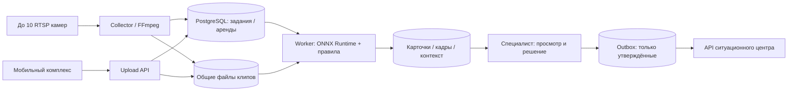

# MVP 2.0: архитектура, границы и протокол

## Что реализовано

- До 10 RTSP/upload источников с раздельными ключами администратора, специалиста, комплекса и центра.
- Постоянный RTSP-приём FFmpeg, сегменты около 5 секунд по ключевым кадрам, переподключение с паузой
  15 секунд. Если 30 секунд нет закрытого сегмента — перезапуск подключения. После восстановления
  новые клипы обрабатываются; пропущенные кадры автоматически не восстанавливаются.
- Долговечная очередь в БД, эксклюзивная аренда задания и источника, восстановление прерванной обработки.
- Локальная ONNX-модель YOLOX Nano (люди/машины/мотоциклы/автобусы/грузовики), CPU или CUDA.
- Настраиваемые зоны и длительность. Исходные клипы, кадры, предшествующий контекст, SHA-256,
  версия модели, координаты объекта на кадре и происхождение времени.
- Обязательное ручное решение, защита от конфликтующих решений, аудит. Интеграция только после утверждения.

Модель обнаруживает объекты; **правила формируют предварительные сигналы, а не правовую квалификацию**.
Перевозка разбитой машины сама по себе не является нарушением. Без специально настроенной ограниченной
зоны сигнал не создаётся. Даже в зоне специалист проверяет необходимость и применимость запрета.

## Перечень сценариев и частота

| Сценарий | Сейчас | Частота / ограничения |
|---|---|---|
| Длительное нахождение ТС в заданной зоне | Реализовано как кандидат на проверку | По умолчанию 0,5 кадра/с, порог 15 с; изменение положения сбрасывает накопление |
| Человек в заданной ограниченной зоне | Реализовано как кандидат | 0,5–2 кадра/с, порог от 3 с; нельзя устанавливать личность/право доступа |
| Свалки, сброс отходов | Не реализовано этой моделью | Нужны профильный датасет/модель, подтверждение назначения площадки; для сброса — более частые кадры |
| Самострой, самозахват, самоуправство | Не реализовано | Нужны эталонная съёмка, кадастр/документы, геопривязка и отдельные правила |
| Номера движущихся ТС, красный свет, скорость | Не реализовано в автоматическом контуре | Нужны профильный детектор/OCR, 5–15+ кадров/с по событию, калибровка; текущий редкий режим непригоден |
| Соцсети | Автоматического сбора нет | Разрешённый внешним источником сборщик может передавать клипы через upload API; сам коннектор — отдельный этап |

Частота задаётся отдельно для источника: 0,2–5 кадров/с. Все кадры RTSP сначала записываются в короткие
клипы; модель обрабатывает выборку. Оценка детектора — уверенность в классе объекта, а не вероятность
правонарушения. Ассоциация объектов по положению простая, без re-ID. Окклюзии и смена ракурса могут
разорвать наблюдение. Одно непрерывное наблюдение не создаёт повторное событие каждый cooldown;
новые наблюдения одного правила ограничены cooldown по умолчанию 120 с.

## Архитектура



Docker Compose использует PostgreSQL 16 и общий volume файлов. Без Docker — SQLite для одного узла.
API не загружает модель; сборщик не выполняет инференс; worker не зависит от веб-интерфейса.
Аренда задания и источника предотвращает одновременную обработку одной камеры несколькими workers.
При обрыве worker задание доступно после истечения аренды 120 с; аренда продлевается во время обработки.
После трёх прерываний задание помечается ошибочным. Нечитаемый файл/ошибка обработки не выдаются за успех.

Для нескольких серверов нужны центральный PostgreSQL и один общий POSIX-каталог/NFS с одинаковыми
относительными путями, синхронизированные часы и доступ к модели на каждом worker. Можно запустить
несколько collectors/workers: аренды распределяют источники/задания, инференс идёт параллельно.
На одном сервере: `docker compose up -d --scale worker=2`. Число воркеров выбирайте по памяти/нагрузке.
SQLite для нескольких хостов не использовать. S3, Kubernetes, аппаратное декодирование и распределённый
мониторинг не реализованы; для большого парка потребуется отдельная эксплуатационная доработка.
Общий короткий mutex сериализует записи метаданных, но не сами вычисления; при большом масштабе
следует заменить его блокировками строк/брокером и провести нагрузочные испытания.

## Оборудование и стоимость

**Бюджетный старт:** CPU 4–8 современных vCPU, RAM 8–16 ГБ, SSD/NVMe от 256 ГБ,
подпотоки H.264 640×360/720p и 0,5 кадра/с. Для запаса на десять декодеров предпочтительны 8 vCPU/16 ГБ.
Это начальная конфигурация для испытаний, не гарантия десяти камер любого разрешения/кодека.
GPU пока не обязательна. Если упираетесь именно в инференс, следующий шаг — NVIDIA с 4–8 ГБ
памяти, актуальный драйвер и NVIDIA Container Toolkit. 24 ГБ ради этого детектора не требуется.

```sh
docker compose -f compose.yaml -f compose.gpu.yaml up -d --build
```

GPU-вариант использует ONNX Runtime CUDA, CUDA 12/cuDNN 9; без доступного CUDA provider worker
откажется стартовать вместо незаметного перехода на CPU. **GPU в текущей среде нет, CUDA-развёртывание
не проверено.** Декодирование остаётся на CPU; GPU не решает все ограничения ввода-вывода.

Измерение на текущей облачной CPU-машине (5 доступных CPU, два потока инференса): медиана ~20 мс,
p95 ~24 мс на одном тестовом изображении после прогрева. Это только детекция: без RTSP, записи,
декодирования и накопления временного правила. Не экстраполируйте его в гарантированную ёмкость.

При 10 потоках по 0,5 Мбит/с записывается около **54 ГБ/сутки**. По 1 Мбит/с — 108 ГБ/сутки.
Клипы без событий хранятся 24 часа (настраивается). Клипы события и контекст сохраняются без
автоматического удаления, включая отклонённые: нужна политика архива/удаления и резервное копирование.
При нехватке места сбор останавливается, UI показывает ошибку. Максимум 300 ожидающих/обрабатываемых
заданий; это ограничивает очередь метаданных, но не общий объём сохранённых доказательных материалов.

## API

Авторизация: `Authorization: Bearer TOKEN`, отдельные значения не короче 24 символов:
`OSC_ADMIN_TOKEN`, `OSC_REVIEWER_TOKEN`, `OSC_INGEST_TOKEN`, `OSC_INTEGRATION_TOKEN`.
Токены должны различаться. Передача по HTTPS; порты Docker по умолчанию доступны только localhost.
Не подставляйте секреты в историю общих терминалов или примеры с реальными значениями.

| Метод | Адрес | Доступ / назначение |
|---|---|---|
| GET | `/health` | Публичный liveness API, не обещание готовности модели |
| GET | `/api/v2/status` | admin/reviewer: очередь, ошибки, свежесть workers/collectors |
| GET/POST | `/api/v2/sources` | Просмотр admin/reviewer; создание admin, лимит 10 |
| PATCH | `/api/v2/sources/{id}` | admin: включение, частота, зоны |
| GET | `/api/v2/sources/{id}/preview` | admin/reviewer: последний обработанный кадр |
| POST | `/api/v2/sources/{id}/uploads` | admin/ingest: multipart `file`, `captured_at`, `latitude`, `longitude` |
| GET | `/api/v2/jobs` | admin/reviewer: последние 100 заданий, ошибки |
| GET | `/api/v2/events?status=pending` | admin/reviewer: pending/approved/rejected/all, лимит до 200 |
| POST | `/api/v2/events/{id}/review` | admin/reviewer: решение с ожидаемой версией |
| GET | `/api/v2/events/{id}/evidence/frame` | Кадр, проверяется SHA-256 |
| GET | `/api/v2/events/{id}/evidence/clip` | Основной клип |
| GET | `/api/v2/events/{id}/evidence/context-{index}` | Предшествующий клип (нумерация с 0) |
| GET | `/api/v2/audit` | admin: последние 200 записей аудита |
| GET | `/integration/v1/events?cursor=0&limit=100` | integration/admin: только утверждённые, последовательный курсор |

У интегратора доступ к материалам есть только для утверждённых событий. До проверки материал возвращает
404 даже при известном UUID. У оператора есть доступ к кандидатам для проверки.

Пример создания источника (сам секрет RTSP не входит в JSON):

```json
{
  "name": "Въезд 01",
  "kind": "rtsp",
  "source_env": "CAMERA_01_URL",
  "enabled": true,
  "sample_fps": 0.5,
  "latitude": 55.66,
  "longitude": 37.86,
  "rules": [{
    "id": "restricted-zone",
    "type": "vehicle_dwell",
    "polygon": [[0.2,0.3],[0.8,0.3],[0.8,0.9],[0.2,0.9]],
    "dwell_seconds": 15,
    "cooldown_seconds": 120
  }]
}
```

Время API — Unix seconds; интерфейс показывает время Москвы (МСК).
Координаты полигона нормированы к кадру. Правило проверяет нижний центр bbox. Это не геодезическая
граница. Для мобильного комплекса `kind=upload`; время/геопозиция могут передаваться для каждого клипа.
Данные загрузчика не считаются независимо проверенными. У RTSP время приблизительно определяется
по часам приёма и временным отметкам сегмента; точная синхронизация камеры с GPS пока не реализована.

Upload отвечает HTTP 202 с `job_id`. Не означает успешный анализ. `Idempotency-Key` необязателен;
по умолчанию ключ строится из SHA-256 и конфигурации правил/частоты. После настройки зоны тот же файл
можно проанализировать повторно. Ошибки: 401/403 — доступ; 409 — лимит источников/состояние/конфликт
версии/целостность материала; 413 — размер; 422 — поля; 429 — очередь; 507 — свободное место.

Решение специалиста:

```json
{"decision":"approved","version":1,"comment":"Материалы просмотрены, признаки подтверждены"}
```

Отклонение: `decision=rejected` с обязательным комментарием. Запись меняется из pending только один раз;
второе/устаревшее решение даёт 409. Протокол исправления уже утверждённого решения ещё не реализован.

Пример интеграционной ленты:

```json
{"items":[{"sequence":12,"event":{"id":"UUID","status":"approved","version":2}}],"next_cursor":12}
```

Центр опрашивает ленту, например раз в 5 секунд, сохраняет события идемпотентно по UUID и обновляет
курсор только после успешного сохранения пакета. Курсор соответствует **порядку утверждения**, а не
обнаружения: поздно проверенные старые события не теряются. Повторное чтение пакета допустимо.
Автоматический push/webhook в неизвестный внешний центр не выполняется. Его API/формат нужно согласовать
перед реальным подключением; текущий REST-контракт — готовая точка интеграции, не подтверждение внешнего обмена.

## Эксплуатационные границы

- Сейчас один reviewer-токен и настроенное имя специалиста, не полноценные персональные учётные записи/SSO.
  Для коммерческой многопользовательской эксплуатации нужны отдельные пользователи, отзыв прав и политика аудита.
- SHA-256 выявляет изменение файлов, но не подтверждает подлинность сцены и не делает комплекс средством
  автоматической фиксации/назначения штрафов. Аудит находится в БД, не является неизменяемым внешним журналом.
- Адреса камер в env могут быть видны администраторам ОС через процессы FFmpeg; токены и БД требуют защиты.
- При смене зоны во время обработки незавершённое старое задание может быть отмечено ошибкой вместо
  сохранения события по устаревшему правилу. Новые задания используют актуальную конфигурацию.
- Для доступа из интернета нужен TLS reverse proxy. Для `/integration/*` проксируйте backend:8000,
  для сайта — web:3000; сохраняйте Authorization. Саму БД наружу не открывать.
- Настоящие десять одновременных внешних камер, GPU и внешний ситуационный центр должны пройти
  приёмочные испытания у заказчика. Они не заменяются тестовыми файлами.

## Модель и происхождение

YOLOX Nano, официальный релиз проекта Megvii, Apache-2.0:
https://github.com/Megvii-BaseDetection/YOLOX

Файл: https://github.com/Megvii-BaseDetection/YOLOX/releases/download/0.1.1rc0/yolox_nano.onnx

SHA-256: `c789161ed43c8269fcd4e67c67eeeb4e80c622da2eb296a20bc6007bd18a0b7d`.
Скачивание только по HTTPS, контрольная сумма обязательна. Другой файл потребует явного обновления
адаптера и проверки, не отключения контроля. Необязательные веса не коммитятся в Git.
